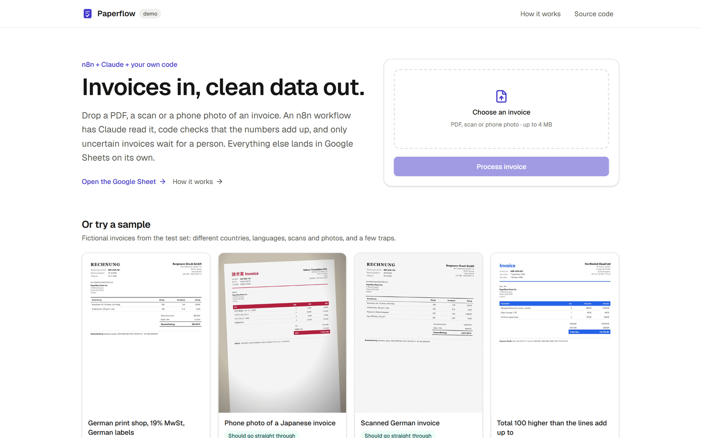
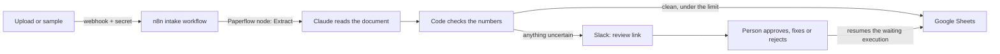
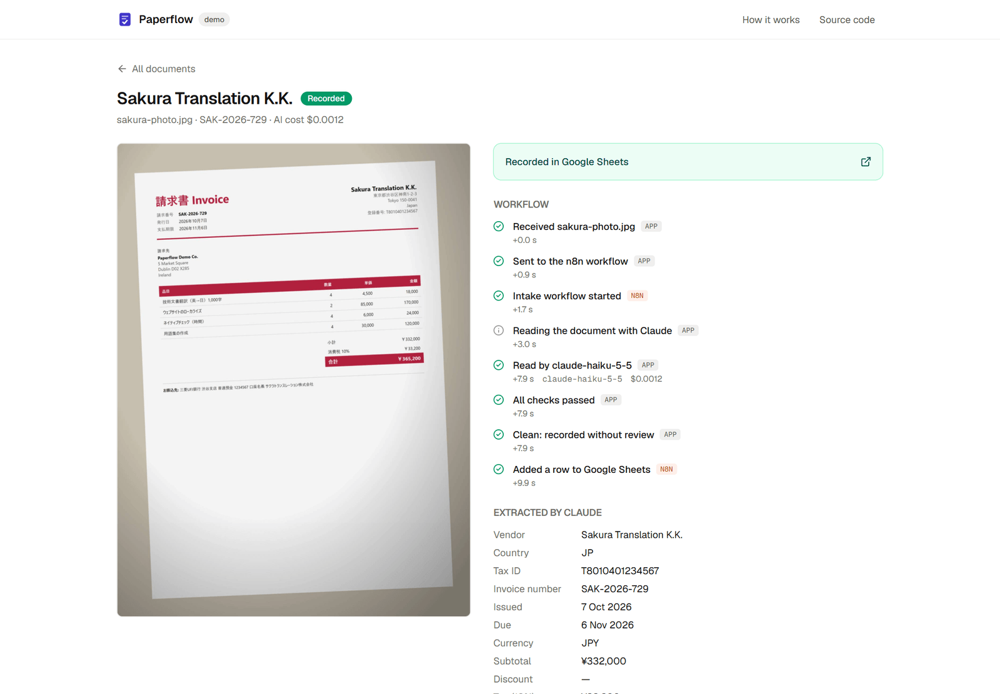
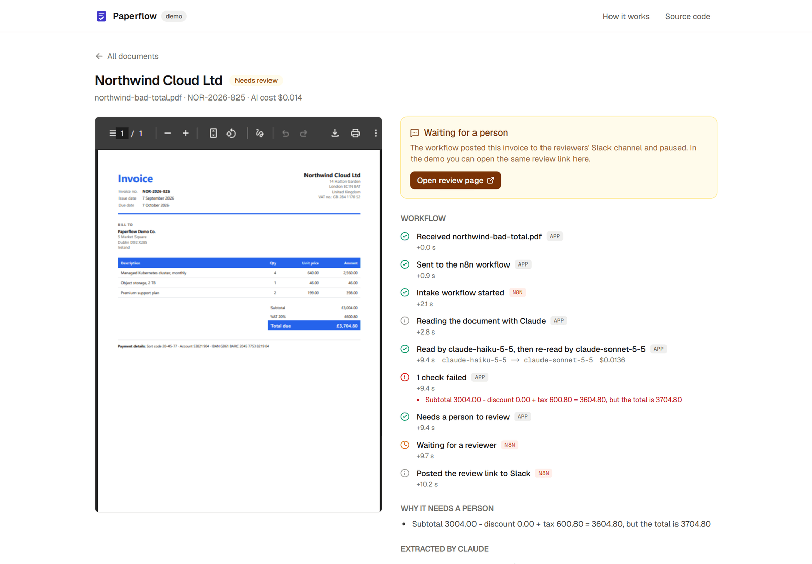
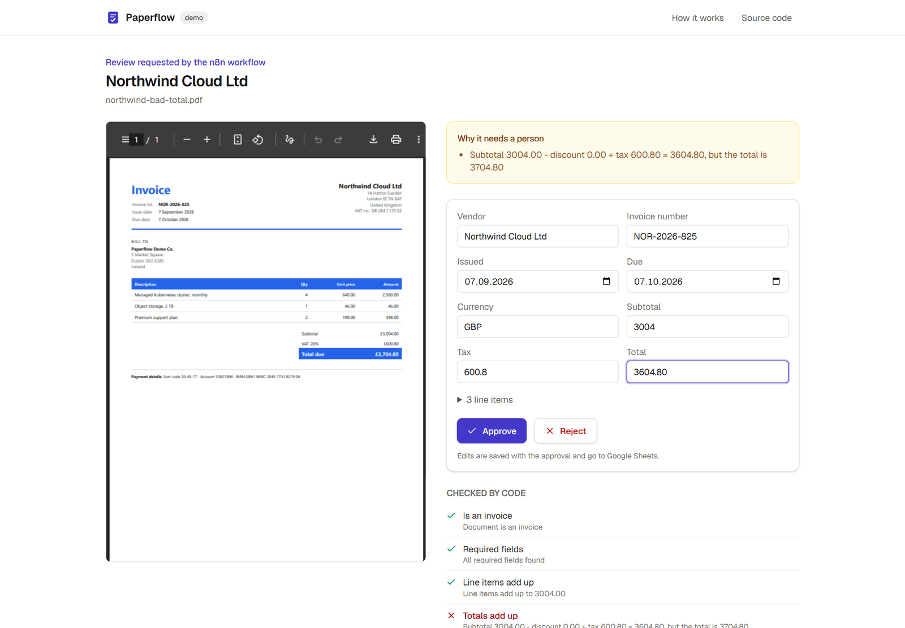
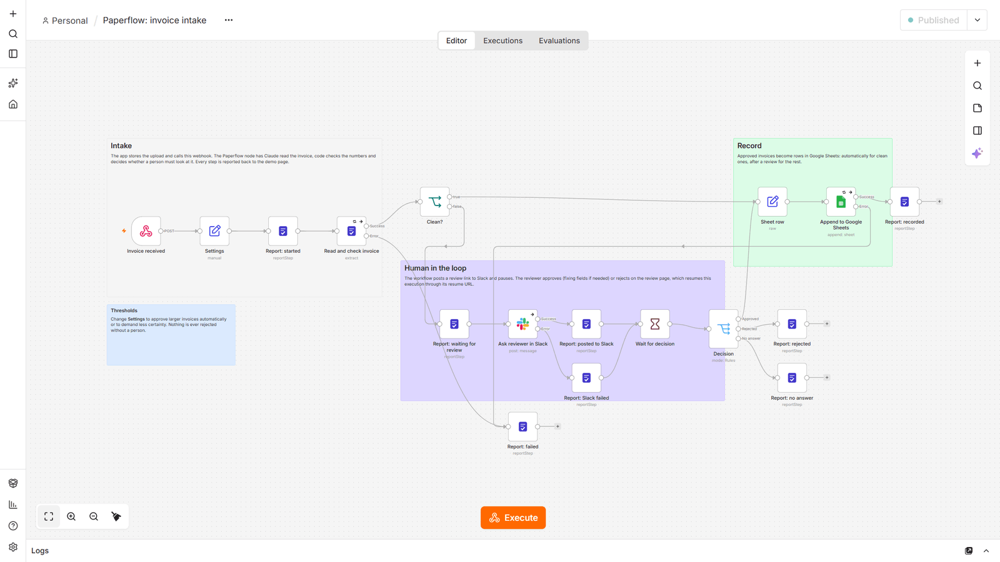
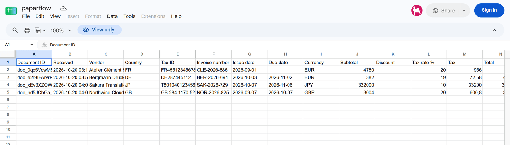

# Paperflow

Invoice processing with n8n and custom code. An invoice arrives as a PDF, a scan or a phone photo. An n8n workflow has
Claude read it into a strict schema, deterministic code checks that the numbers add up, a person approves anything
uncertain from a Slack link, and the result lands in Google Sheets.

**[Live demo](https://paperflow-seven.vercel.app)** · [the Google Sheet it writes to](https://docs.google.com/spreadsheets/d/1POZNDac6cu065aOcPgpgBAsin-POBAotUK8_xzSUpxg/edit?gid=0) · [n8n node](packages/n8n-nodes-paperflow) · [workflows](n8n/workflows) · [eval](packages/eval)



## How it works



1. **n8n receives it.** The web app stores the file and calls the intake workflow's webhook (header secret).
2. **Claude reads it.** A custom n8n node calls the app's extraction API. Claude Haiku reads the PDF or image into a
   strict schema; when a reading looks unreliable, Claude Sonnet reads it again.
3. **Code checks it.** Line items add up, subtotal + tax = total, the tax matches the rate, dates make sense, the
   currency is known, the invoice isn't a duplicate (same file or same vendor and number), and the document has no
   text trying to instruct the AI. The model only reads; code decides.
4. **A person decides when it matters.** Invoices that fail a check, contain an unsure field or exceed the
   auto-approval limit ($5,000 by default) go to Slack with a signed, single-use review link, and the execution pauses
   on a Wait node. The review page resumes it with the decision and any corrections.
5. **Data lands in Sheets.** Clean invoices are appended automatically, approved ones after the review. Nothing is
   ever rejected without a person.

Every step reports back to the document's timeline, so the demo page shows what n8n is doing in real time.

| Clean invoice, recorded in 12 seconds                | Total doesn't add up: waiting for a person         |
| ---------------------------------------------------- | -------------------------------------------------- |
|  |  |

| The review page (fixing the total)               | The intake workflow in n8n                         |
| ------------------------------------------------ | -------------------------------------------------- |
|  |  |



## What's worth a look

- **A real n8n node, not an HTTP Request node with a pasted token.**
  [`n8n-nodes-paperflow`](packages/n8n-nodes-paperflow) is built with n8n's official `@n8n/node-cli` and passes its
  strict lint: Extract, Get and Report Step operations, a credential with a connection test, light and dark icons.
- **Workflows in git.** [`n8n/workflows`](n8n/workflows) is imported into n8n on every start, and `pnpm n8n:export`
  writes editor changes back without timestamps and version IDs. Credentials are built from environment variables and
  encrypted by n8n on import, so a fresh container comes back exactly as it was.
- **Human in the loop that survives restarts.** The review uses n8n's resume URL, not Slack's "send and wait": the
  reviewer gets a page with the original document and editable fields, the link is HMAC-signed and single-use, and a
  Slack outage doesn't lose the invoice (the step is reported and the link still works).
- **Failures are visible.** Error outputs on the steps that can fail report to the document's timeline; anything else
  triggers the error workflow, which alerts Slack.
- **Prompt injection is a check, not a hope.** One sample hides white text telling the AI to approve the invoice. The
  model flags it, and the flag sends the invoice to a person.
- **Measured, not assumed.** The model choice comes from an eval on generated invoices (below), with the routing
  graded as well as the fields.

## Eval

31 synthetic documents generated by [`packages/eval`](packages/eval): 7 fictional vendors in 7 currencies and 6
languages, rendered to PDF, plus "scans" (rotated, noisy, grayscale) and phone photos. The set includes a wrong total,
a duplicate, a quote that isn't an invoice, an invoice above the limit, a date that only the vendor's country can
disambiguate, and hidden instructions for the AI.

| Metric                                 | Haiku 5.5 | Sonnet 5.5 | Cascade (used) |
| -------------------------------------- | --------- | ---------- | -------------- |
| Documents with every field right       | 31/31     | 31/31      | 31/31          |
| Correct route (auto-approve vs review) | 31/31     | 31/31      | 31/31          |
| **Wrongly auto-approved**              | **0**     | **0**      | **0**          |
| Ambiguous values flagged               | 5/5       | 5/5        | 5/5            |
| Cost per document                      | $0.0010   | $0.0167    | $0.0050        |
| Median time per document               | 4.2 s     | 3.6 s      | 4.1 s          |

The cascade costs a third of Sonnet and keeps a second opinion for the documents where Haiku is unsure or a check
fails (7 of 31 here). Full results: [`packages/eval/results.md`](packages/eval/results.md); run it with
`pnpm --filter @paperflow/eval eval`.

## Layout

```
apps/web                    Next.js app: demo page, live timeline, review page, API for n8n (Postgres via Drizzle)
packages/extraction         Invoice schema, Claude extractor (PDF and images), checks, routing, cascade
packages/n8n-nodes-paperflow  The n8n community node
packages/eval               Synthetic invoice generator and the eval
n8n/                        n8n image: Dockerfile, entrypoint, credentials from env, workflows
```

## Run locally

Requires Node 22+, pnpm and Docker.

```bash
pnpm install
cp .env.example .env                      # without an Anthropic key a fake extractor answers for the samples
pnpm dev:n8n                              # builds the node, starts n8n and Postgres in Docker
pnpm --filter @paperflow/web db:migrate
pnpm --filter @paperflow/web dev          # http://localhost:3000
```

Without Slack and Google credentials in `.env` the workflow still runs; the Slack and Sheets steps report that they
failed on the document's timeline.

## Deployment

- **Web app:** Vercel (`apps/web`), Postgres on Neon, a daily cron deletes demo uploads after 72 hours.
- **n8n:** the image from [`n8n/`](n8n) on Render. GitHub Actions builds it into GitHub Container Registry and calls
  the Render deploy hook; another job pings it every 10 minutes so the free instance doesn't fall asleep. n8n keeps its
  state in a separate Neon database.
- **CI:** format, types, lint (including n8n's node linter), tests and build on every push.

## Stack

TypeScript, Next.js 16, React 19, Tailwind 4, Drizzle, Postgres (Neon), n8n 2.43, Claude (Anthropic SDK, structured
outputs), Slack API, Google Sheets API, Docker, Playwright and sharp (eval data), Vitest, GitHub Actions.
